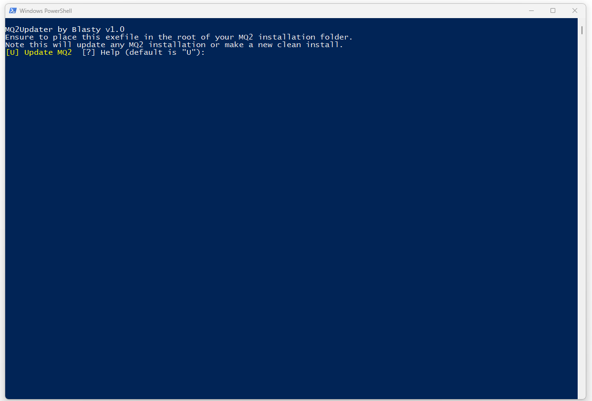
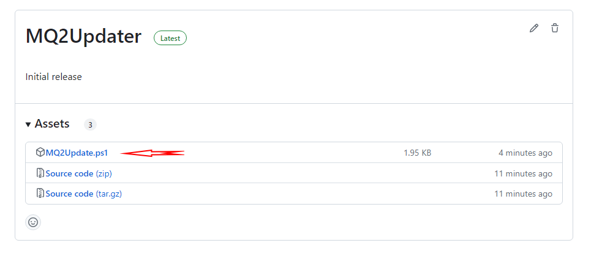
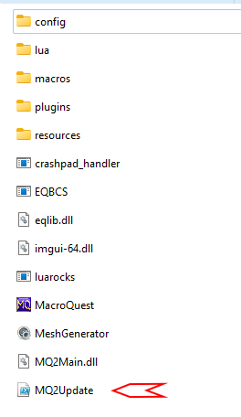
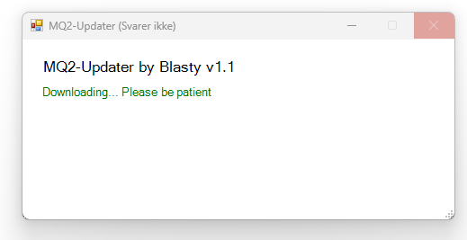
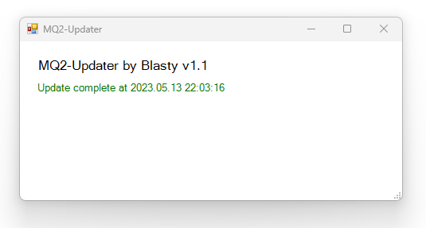

# MQ-Updater

A small PowerShell tool with a graphical window that updates an existing [MacroQuest](https://github.com/macroquest/macroquest) (MQ) installation to the latest official release, or makes a clean new install, in one click.

It works with any existing MQ installation, including installs from RedGuides and setups with class plugins.



## Features

- **One-click update.** Downloads the latest official MQ live release (`rel-live`) and unpacks it over your current installation.
- **New install.** If no `MacroQuest.exe` is found in the folder, the button changes to **New Install** and sets up MQ from scratch.
- **Running check.** Detects if MQ is running and stops before anything is overwritten.
- **Extra resources.** Also fetches an updated EasyFind `ZoneConnections.yaml` and a guild hall navmesh for MQ2Nav.
- **No installation.** One `.ps1` file, no dependencies beyond what ships with Windows.

## Requirements

- Windows 10 or 11
- Windows PowerShell 5.1 (included with Windows)
- Internet access to GitHub

## How to use

1. Download the latest `MQ-Update.ps1` from [Releases](https://github.com/Zoh63392187/MQ-Updater/releases/).

   

2. Place the file in the root of your MQ folder (the folder that contains `MacroQuest.exe`). For a new install, place it in an empty folder where you want MQ.

   

3. Make sure MQ is **not** running.

4. Right-click `MQ-Update.ps1` and choose **Run with PowerShell**. The window looks like this:

   

5. Click **Update MQ** (or **New Install**). The script downloads the latest release:

   

6. When it's done, the window shows a completion time:

   

Launch MQ and have fun. Game on!

### If Windows blocks the script

Files downloaded from the internet may be blocked by the PowerShell execution policy. Unblock the file once with:

```powershell
Unblock-File .\MQ-Update.ps1
```

Or run it for this session only:

```powershell
powershell -ExecutionPolicy Bypass -File .\MQ-Update.ps1
```

## What the script does

1. Checks whether `MacroQuest.exe` exists in the current folder, and whether MQ is running (by trying to open `crashpad_handler.exe` for writing).
2. Downloads `MacroQuest.zip` from the official release:
   `https://github.com/macroquest/macroquest/releases/download/rel-live/MacroQuest.zip`
3. Extracts the archive over the current folder (existing files are overwritten; your config files that aren't in the archive are left alone).
4. Deletes the downloaded zip file.
5. Downloads `resources/EasyFind/ZoneConnections.yaml` and `resources/MQ2Nav/guildhalllrg.navmesh`.

## EverQuest patch day

When EverQuest patches and MQ is out of date, just run the script again.

The updater can only install what the MQ developers have released. If MQ hasn't been updated for the current EverQuest version yet, wait a while (usually about an hour) and try again. You can follow releases here: [Official MQ releases](https://github.com/macroquest/macroquest/releases/).

## Troubleshooting

| Message | Cause and fix |
| --- | --- |
| `MQ is running - aborting!` | Close MacroQuest (and EverQuest if needed) and run the script again. |
| `MQ update Failed!` | The download or extraction failed. Check your internet connection and that the folder isn't read-only, then try again. |
| `EasyFind Failed!` / `Guildhall mesh failed` | The MQ update itself may have succeeded. Only the extra resource file couldn't be downloaded. |

## Credits

All credit for MacroQuest goes to the [MQ developers](https://github.com/macroquest/macroquest) and the hard work they do. This tool just downloads their official releases.

MQ-Updater is made by Blasty.

## License

Released under the [GNU General Public License v3.0](LICENSE).
